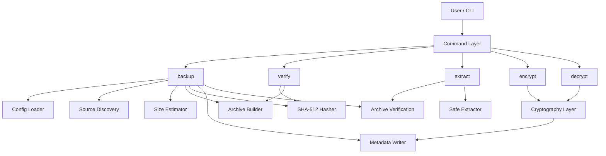

# Technical Design Document (TDD)

**Project:** ztarcompress  
**Feature:** secure backup, verification, extraction, and optional encryption  
**Author:** Project Owner  
**Date:** 2026-08-31  
**PRD Reference:** [docs/PRD.md](docs/PRD.md)  
**ADR References:** accepted ADRs are the decision log; ADR-009 remains deferred as a future feature

---

## 1. Purpose and Scope

This document defines the implementation design for a Python CLI that creates TAR + Zstandard backup archives, verifies them, extracts them safely, and optionally encrypts and decrypts the archive files.

The MVP is intentionally limited to the workflow:

1. `backup`
2. `verify`
3. `extract`
4. optional encryption/decryption as separate commands

The project principles are:

- correctness over feature breadth,
- single-responsibility commands,
- explicit failure handling,
- safe extraction and verification,
- maintainability for a junior-to-intermediate maintainer.

### 1.2 Accepted project decisions

- ADR-001, ADR-002, ADR-003, ADR-004, ADR-005, ADR-006, ADR-007, ADR-008, and ADR-010 are accepted and reflected in the design while ADR-009 is proposed for future deep verification.

These are the decisions already approved for the MVP and reflected in the project design:

- Use Python 3.14+ with `tarfile` Zstandard support.
- Use Astral uv for local install, build, and execution on Linux.
- Keep `backup`, `verify`, `extract`, `encrypt`, and `decrypt` as separate commands with single responsibility.
- Use SHA-512 as the single archive hash standard.
- Store backup metadata in a separate `metadata.json` file, not in `config.toml`.
- Preserve symlinks as symlinks and do not follow them during backup.
- Preserve hardlinks where the archive format supports them.
- Use the real directory names in the archive by default; do not add a synthetic `source-001/` wrapper.
- Fail the backup if a source file disappears or becomes unreadable during archive creation.
- Extract safely by default and never overwrite existing files silently.
- Use glob-style exclusion patterns relative to each source root.
- Verify by checking both the SHA-512 hash and archive readability.
- Support Linux as the official MVP target.

### 1.3 Tooling and runtime requirements

The project uses Astral uv as the standard toolchain for installing dependencies and running the CLI. Users are expected to install uv on Linux before using ztarcompress. This is a tooling decision for project execution, not a design ADR.

- install.sh is expected to automate the Linux install flow and install uv if it is missing.
- Ruff is the intended formatter and linter for the project.

---

## 2. System Architecture

### 2.1 High-Level Architecture Diagram



### 2.2 Components

| Component | Description | Technology | Responsibility |
| --- | --- | --- | --- |
| Command Layer | CLI entry points | argparse / Python CLI | Parse user input and dispatch single-responsibility actions |
| Config Loader | Reads and validates `config.toml` | Python stdlib `tomllib` | Load sources, exclusions, backup dir, retention settings |
| Source Discovery | Enumerates configured paths | `pathlib`, `os` | Resolve `~`, validate directories, collect files for backup |
| Size Estimator | Calculates approximate size before backup | `os.scandir`, `pathlib` | Show size and path list before confirmation |
| Archive Builder | Builds TAR + Zstandard archive | Python 3.14 `tarfile`, Zstandard support | Create a valid archive from allowed source entries |
| Hashing Layer | Computes file digests | `hashlib` | Compute SHA-512 for archive and encrypted artifact |
| Metadata Manager | Reads and writes `metadata.json` | `json`, atomic file writes | Store archive metadata, hashes, sizes, and history |
| Verification Engine | Validates archive readability and hash | `tarfile`, hashing | Confirm archive integrity before reporting success |
| Safe Extractor | Extracts archive content safely | `tarfile` | Reject traversal attempts and unsafe extraction |
| Encryption Layer | Encrypts/decrypts archive bytes | `cryptography` | Encrypt `.tar.zst` to `.tar.zst.enc` and reverse it |
| Logging Layer | Diagnostics and warnings | `logging` | Record important operational details without exposing secrets |

### 2.3 Data Flow

1. User invokes a command.
2. The command validates configuration and resolves paths.
3. For backup:
   - source directories are discovered,
   - file sizes are calculated,
   - confirmation is requested unless `-y/--yes` is set,
   - archive is created,
   - SHA-512 is calculated,
   - archive is opened to validate integrity,
   - metadata is written atomically,
   - final artifact is published.
4. For verify:
   - archive hash is loaded from metadata,
   - current file hash is computed,
   - archive is reopened and members are enumerated,
   - result is reported.
5. For extract:
   - archive is verified,
   - extraction is performed with path-safety checks,
   - extracted files are written to a target directory.
6. For encrypt/decrypt:
   - an existing archive is used as input interactively or via option/flag for automation users,
   - password is requested interactively(MVP interactively only for security),
   - encrypted or decrypted file is produced as a new artifact,
   - metadata is updated with the relevant SHA-512.
7. On any failure:
   - no partial final artifact is published,
   - no false success status is reported,
   - errors are explicit and structured.

---

## 3. Detailed Design

### 3.1 Command Design

| Command | Primary Responsibility | Input | Output |
| --- | --- | --- | --- |
| `backup` | Create a valid archive from configured sources | config + sources + confirmation | timestamped `.tar.zst` + metadata record |
| `verify` | Validate a backup archive without restoring it | archive path + metadata | success/failure result |
| `extract` | Extract a validated archive to a target location | archive path + destination | extracted content |
| `encrypt` | Encrypt an existing archive | `.tar.zst` + password | `.tar.zst.enc` + metadata |
| `decrypt` | Decrypt an encrypted archive | `.tar.zst.enc` + password | decrypted archive + metadata |
| future `full-verify` | Deep verification with decryption/extraction/content comparison | encrypted or archive artifact | stronger integrity assurance |

These commands are intentionally separate so a user can verify or extract an archive without needing source-directory logic, and encryption remains independent from backup creation.

### 3.2 Data Model and File Layout

#### 3.2.1 Config Model
>
> An exclusion prevents the path from entering the archive and should also affect the pre-backup size calculation.

`config.toml` is the user-edited configuration and is not treated as backup metadata.

Example:

```toml
sources = [
  "~/Documents",
  "~/.config",
  "~/.mozilla"
]

exclude = [
  "**/node_modules",
  "**/.venv",
  "**/__pycache__",
  "**/.ruff_cache"
]

backup_directory = "~/Backups"
metadata_retention = 10
```

Design rules:

- user paths are expanded via `Path.expanduser()`,
- source directories are validated before backup,
- exclusions are applied before archive creation,
- invalid config results in a clear structured error.

Path expansion:

```text
~
environment variables
relative paths
nonexistent paths
```

Validation is also important.

For example:

```text
metadata_retention = -3
```

should fail before a backup begins.

Don't let configuration parsing be responsible for filesystem work. Keep:

```text
parse/validate config
```

separate from:

```text
check whether source exists
```

#### 3.2.2 Metadata Model

`metadata.json` is generated by the tool and stores information about specific backup artifacts.

Example:

```json
{
  "schema_version": 1,
  "records": [
    {
      "id": "backup-20260831-103000",
      "created_at": "2026-08-31T10:30:00Z",
      "archive": "backup-20260831-103000.tar.zst",
      "archive_sha512": "a1b2c3d4e5f6...0123456789abcdef",
      "archive_size": 123456789,
      "encrypted": null,
      "encrypted_sha512": null,
      "encrypted_size": null,
      "decrypted": null,
      "decrypted_sha512": null,
      "decrypted_size": null,
      "extracted_dir": null,
      "extracted_size": null,
      "source_directories": [
        "~/Documents",
        "~/.config"
      ],
      "status": "archived"
    },
    {
      "id": "backup-20260831-150500",
      "created_at": "2026-08-31T15:05:00Z",
      "archive": "backup-20260831-150500.tar.zst",
      "archive_sha512": "f9e8d7c6b5a493827160...abcdef",
      "archive_size": 987654321,
      "encrypted": "backup-20260831-150500.tar.zst.enc",
      "encrypted_sha512": "7a6b5c4d3e2f1a0b9c8d7e6f5a4b3c2d1e0f9a8b7c6d5e4f3a2b1c0d9e8f7",
      "encrypted_size": 1012345678,
      "decrypted": "backup-20260831-150500.tar.zst.enc-decrypted",
      "decrypted_sha512": "9f8e7d6c5b4a3928171605...abcdef",
      "decrypted_size": 987665432,
      "extracted_dir": "restore-backup-20260831-150500",
      "extracted_size": 1234567890,
      "source_directories": [
        "~/Documents",
        "~/Projects",
        "~/.config"
      ],
      "status": "extracted"
    }
  ]
}
```

Design rules:

- `schema_version` records the backup format version, not application version.
- Only one SHA-512 algorithm is used.
- Hashes are computed over the exact artifact bytes.
- Metadata is append-only for new backups and pruned to the configured maximum retention value.
- Writes are atomic, so a failed operation never leaves a partial metadata file.

### 3.3 Functional Architecture

##### 3.3.1 Configuration and Source Discovery

Responsibilities:

- read config,
- expand paths,
- validate directories exist,
- reject unreadable or invalid source paths,
- derive exclusions,
- collect candidate files to archive.

Important behavior:

- multiple source directories are supported,
- the tool should avoid silently ignoring invalid sources,
- backup must fail early and clearly if config is unusable.

#### 3.3.2 Source Size Estimation

Responsibilities:

- calculate total approximate size of pending sources,
- show directory and size summary before confirmation,
- support non-interactive flows with `-y/--yes`.

Important behavior:

- use streaming or reasonably efficient directory walking,
- avoid expensive full in-memory loads,
- print summary in user-readable form.

#### 3.3.3 Archive Creation

Responsibilities:

- build a tarball using GNU TAR format,
- compress with Zstandard using Python 3.14 tarfile support,
- preserve normal files and directories,
- preserve symlinks and hardlinks where supported,
- skip FIFOs with warning,
- include directory boundaries to prevent collisions between configured sources.

Important design choice:

- each configured source is placed under a named root entry, rather than flattening everything into a single root. This avoids collisions between directories like `Documents/README.md` and `Projects/README.md`.

#### 3.3.4 Verification

Responsibilities:

- compute SHA-512 for the produced archive,
- compare with stored metadata,
- reopen archive in read mode,
- enumerate archive members to confirm readability.

Important behavior:

- normal verification does not require a password,
- verification must fail if the archive file is unreadable or corrupted,
- the tool must never report success without verification.

#### 3.3.5 Extract

Responsibilities:

- verify the archive,
- extract into a target directory,
- prevent path traversal and absolute-path writes,
- handle existing-path conflicts explicitly.

Important behavior:

- extraction must reject dangerous members,
- extraction should be safe and conservative,
- extraction should not silently overwrite files unless explicitly designed later.

#### 3.3.6 Encryption and Decryption

Responsibilities:

- accept an existing archive as input,
- request the user password interactively in the MVP,
- create a new encrypted file with a clear naming pattern,
- save the encrypted file SHA-512 in metadata,
- create decrypted artifacts without deleting the original encrypted or source archive.

Important behavior:

- encryption and decryption are separate commands,
- encryption does not act on source directories,
- wrong password or corruption yields a structured error and does not claim success.

#### 3.3.7 Deep Verification

This is a future expensive verification step:

- decrypt if necessary,
- open the archive,
- extract to a temporary directory,
- compare selected file contents against expectation,
- clean up temporary extraction data.

This is intentionally not part of the normal backup verification path, because the full extraction-style check is relatively expensive.

#### 3.3.8 Error Handling

Use frozen dataclasses + enums + data-driven error messages rather than printing and exiting everywhere and with this approach, support `--json` output for structured error reporting and for automation users.

```python
@dataclass(frozen=True)
class AppMessage:
    code: MessageCode
    message: str
    level: LogLevel
```

and:

```python
class MessageCode(Enum):
    SOURCE_NOT_FOUND = auto()
    SOURCE_NOT_READABLE = auto()
    BACKUP_FAILED = auto()
    ARCHIVE_INVALID = auto()
    HASH_MISMATCH = auto()
    ENCRYPTION_FAILED = auto()
    DECRYPTION_FAILED = auto()
    EXTRACT_FAILED = auto()
    ...
```

and use dict keys:

```python
ERROR_MESSAGES: dict[MessageCode, str] = {
    MessageCode.SOURCE_NOT_FOUND: "Source directory not found: {path}",
    MessageCode.SOURCE_NOT_READABLE: "Source directory not readable: {path}",
    ...
}
WARNING_MESSAGES: dict[MessageCode, str] = {
    MessageCode.FIFO_SKIPPED: "FIFO entry skipped: {path}",
    ...
}
```

Then your CLI can decide how to present the message and whether to exit with a non-zero code.

The key architectural idea is:

```text
operation
   ↓
structured result/error
   ↓
CLI presentation
```

rather than functions everywhere doing:

```python
print("ERROR!!!")
sys.exit(1)
```

#### 3.3.9 Return structured results

Support --json output for automation users and structured error reporting. Use frozen dataclasses to return results from operations rather than printing and exiting everywhere.

```python
@dataclass(frozen=True)
class BackupResult:
    archive: Path
    sha512: str
    size: int
```

Then:

```python
result = backup(...)
```

and the CLI decides how to display it.

Likewise:

```python
@dataclass(frozen=True)
class VerifyResult:
    valid: bool
    sha512_matches: bool
    archive_readable: bool
```

#### 3.3.10 Atomically create temporary file

> **A final backup artifact is never published until it has completed its operation successfully.**

For:

```text
backup-...tar.zst
backup-...tar.zst.enc
```

create temporary files:

```text
backup-...tar.zst.tmp
backup-...tar.zst.enc.tmp
```

#### 3.3.11 Components/Modules responsibilities

cli.py
    user input / command routing / presentation

config.py
    load/save configuration

models.py
    frozen dataclasses / result objects / enums

exceptions.py
    domain-specific exceptions

verification.py
  archive verification / full verification

encryption.py
  password-based encryption/decryption

metadata.py
    metadata.json related tasks  / hashing

Responsible for:

```text
load metadata.json
validate it
add backup record
find record
update encryption information
remove old records
save atomically
```

Configuration controls retention:

```toml
metadata_retention = 10
```

Default:

```text
10
```

If the user sets:

```toml
metadata_retention = 50
```

you keep 50.

This is a nice distinction:

```text
config.toml
    = instructions/preferences

metadata.json
    = generated history/state
```

Use the same temporary-file + atomic replacement strategy:

filesystem.py
    path resolution / source traversal / size calculation / exclusions

Responsible for things such as:

```text
expand ~/...
resolve source paths
check readability
walk directories
apply exclusion patterns
calculate total size
identify supported/unsupported filesystem entries
```

It should decide things like:

```text
regular file → include
directory → include
symlink → preserve
FIFO → skip + warning
device → skip + warning
```

Filesystem will contain many edge cases:

- symlink handling
- hardlinks
- inaccessible files
- files changing during backup
- permission errors
- unusual filenames
- exclusion semantics
- directories crossing filesystem boundaries
- race conditions between checking and reading
- file system inconsistencies

Don't try to solve every race condition. Your project explicitly provides **best-effort consistency**.

archive.py
    create/read/extract TAR+Zstandard

Something conceptually like:

```python
create_archive(...)
inspect_archive(...)
extract_archive(...)
```

Using Python 3.14+'s `tarfile` Zstandard support keeps this pleasantly small. Python documents `w:zst` and `r:zst` modes for TAR/Zstandard archives.

This is where backup correctness gets serious.

You need to settle:

- GNU format
- archive root structure
- symlink handling
- hardlinks
- unsupported files
- metadata preservation
- extraction security
- path traversal
- archive corruption
- duplicate names

For restoration, explicitly use the safe `data` extraction filter rather than relying on defaults. Python 3.14 changed the default extraction filter accordingly, but explicit use makes your safety requirement clear in code.

---

## 4. Implementation Plan

### 4.1 Phases

| Phase | Component                        |      Estimate | Milestone                        |
| ----- | -------------------------------- | ------------: | -------------------------------- |
| 0     | Project skeleton + tooling       |      2–3 days | Tests/type checking run          |
| 1     | Domain models + errors/messages  |      3–5 days | Stable data contracts            |
| 2     | Configuration                    |      3–5 days | Valid `config.toml`              |
| 4     | Filesystem + exclusions          |   1–1.5 weeks | Source discovery works           |
| 5     | TAR + Zstandard archive          |   1–1.5 weeks | Real archive can be created/read |
| 6     | Metadata history and hashing                 |      3–5 days | `metadata.json` works            |
| 7     | Verification                     |      4–7 days | `backup → verify` works          |
| 8     | Backup orchestration             |      4–7 days | First real MVP                   |
| 9     | Extract                          |      4–7 days | `backup → verify → extract`      |
| 10    | CLI polish + integration testing |      3–5 days | MVP release candidate            |
| 11    | Encryption                       | 1.5–2.5 weeks | `encrypt` works                  |
| 12    | Decryption                       |      3–5 days | `decrypt` works                  |
| 13    | Encrypted verification           |      3–5 days | `.enc` verification              |
| 14    | Full/deep verification           |     1–2 weeks | Strong verification mode         |

### 4.2 Task Breakdown

| Task | Priority | Status |
| --- | --- | --- |
| Create CLI command scaffold | P0 | Not Started |
| Implement `config.toml` loader and validation | P0 | Not Started |
| Implement source discovery and size estimation | P0 | Not Started |
| Implement TAR + Zstandard archive creation | P0 | Not Started |
| Implement SHA-512 hashing and metadata writing | P0 | Not Started |
| Implement `verify` flow and corruption detection | P0 | Not Started |
| Implement safe `extract` extraction | P0 | Not Started |
| Implement `encrypt` and `decrypt` | P1 | Not Started |
| Implement deep verification path | P2 | Not Started |
| Add logging, warnings, and error codes | P0 | Not Started |
| Add unit and integration tests | P0 | Not Started |

### 4.3 Migration / Rollout Strategy

This project is a standalone CLI and does not require a database migration or service deployment strategy. The rollout approach is instead a staged release model:

1. Release the unencrypted `backup -> verify -> extract` flow first.
2. Validate metadata and archive safety in real-world usage.
3. Add encryption/decryption once the core backup workflow is stable.
4. Add deep verification only after users have a reliable baseline workflow.

---

## 5. Testing Strategy

### 5.1 Test Types

| Test Type | Coverage | Tools |
| --- | --- | --- |
| Unit Tests | Pure logic: config parsing, path expansion, exclusion matching, hash generation, metadata pruning | pytest |
| Integration Tests | Real file generation, archive creation, extraction, verify, encryption/decryption | pytest |
| Failure Tests | Corrupt archive, wrong password, invalid config, path traversal attempts, partial-write scenarios | pytest |
| Regression Tests | Re-run critical flows after refactors | pytest |

### 5.2 Test Cases

| ID | Description | Expected result | Priority |
| --- | --- | --- | --- |
| TC-001 | Load valid `config.toml` with multiple sources | Config loads and paths are expanded correctly | P0 |
| TC-002 | Load invalid config with missing directory | Operation fails before backup begins | P0 |
| TC-003 | Exclude configured patterns like `node_modules` and `.ruff_cache` | Those paths are not archived | P0 |
| TC-004 | Calculate size for nested directory tree | Total size is reported before confirmation | P0 |
| TC-005 | Run backup with `-y` flag | Backup proceeds without interactive confirmation | P0 |
| TC-006 | Create archive from populated directories | Archive is readable with Python `tarfile` | P0 |
| TC-007 | Verify archive generated from backup | Verification succeeds when archive is valid | P0 |
| TC-008 | Corrupt archive after creation | Verification fails | P0 |
| TC-009 | Extract archive into an empty directory | Original file structure is extracted | P0 |
| TC-010 | Attempt path traversal during extraction | Extraction is blocked | P0 |
| TC-011 | Backup symlinks and hardlinks where supported | Link metadata is preserved according to policy | P0/P1 |
| TC-012 | Skip FIFO entries | FIFO is ignored and warning is logged | P0 |
| TC-013 | Archive filenames with spaces and unicode | File names survive archive and extracted | P0 |
| TC-014 | Write metadata with multiple backup entries | Metadata history can be appended and retained | P0 |
| TC-015 | Enforce default metadata retention of 10 | Oldest records are pruned | P0 |
| TC-016 | Encrypt an existing archive | New `.tar.zst.enc` artifact is produced | P1 |
| TC-017 | Decrypt an encrypted archive | New decrypted archive is produced without deleting the source | P1 |
| TC-018 | Wrong password for decrypt | Operation fails cleanly | P1 |
| TC-019 | Ensure final artifact is published atomically | No partial final artifact remains after failure | P0 |
| TC-020 | Validate CLI warnings for active file changes | Tool clearly warns about best-effort snapshot semantics | P0 |

### 5.3 Detailed tests

Your MVP test matrix should now explicitly reflect the command boundaries.

### `backup`

```text
source exists
source missing
permission denied
empty directory
excluded directory
special files
symlink
hardlink
unicode filename
large file
changing file
successful archive
failed archive
SHA-512 generation
metadata generation
atomic output
```

### `verify`

```text
valid archive
corrupted archive
hash mismatch
missing metadata
metadata mismatch
invalid TAR
invalid Zstandard
```

### `encrypt`

```text
valid archive
password entered
wrong/invalid password handling
existing destination
partial failure cleanup
encrypted SHA-512
metadata update
```

### `decrypt`

```text
correct password
wrong password
corrupt encrypted artifact
missing encrypted file
existing output
partial failure cleanup
```

### `extract`

```text
valid archive
invalid archive
safe path handling
symlink
hardlink
permissions
FIFOs
existing destination
partial extraction
```

### `full-verify`

```text
archive extracts
expected files exist
file hashes match
file size matches
missing file detected
modified file detected
extra file behavior defined
temporary extraction cleanup
```

---

## 6. Deployment & Monitoring

### 6.1 Deployment Strategy

This is a local CLI project rather than a hosted service. The deployment model is simple:

- users install the Python package in their environment,
- the CLI reads project-local or home-directory config,
- backup output is placed in a user-selected backup directory.

### 6.2 Logging and Diagnostics

Use Python logging with:

- INFO: normal archive creation and success messages,
- WARNING: skipped FIFOs, changed files, or non-fatal warnings,
- ERROR: invalid config, corrupted archive, wrong password, unsafe extraction attempt,
- DEBUG: low-level diagnostic details useful during development.

Important:

- passwords must never be logged,
- user-facing errors must be clear and stable,
- warnings should be actionable rather than opaque.

### 6.3 Monitoring

This project does not operate as a service, so monitoring is limited to:

- archive integrity checks,
- metadata validity,
- extraction safety checks,
- warning count for skipped non-archiveable entries.

---

## 7. Security Considerations

- Passwords are handled interactively and never written to logs.
- Encryption uses a maintained cryptography library rather than a custom implementation.
- Archive extraction blocks path traversal and absolute path writes.
- SHA-512 is used only for integrity checking, not as an authentication mechanism.
- Metadata is stored separately from user configuration and must be treated as generated operational data.
- The project intentionally avoids remote synchronization or cloud storage in the MVP.

---

## 8. Risks and Mitigations

| Risk | Impact | Mitigation |
| --- | --- | --- |
| Files change while backup is running | Archive may not reflect a perfect snapshot | Warn users to close active editors/browsers where practical; document best-effort semantics |
| Corrupted archive passes incomplete validation | False success could lead to data loss | Require both hash verification and archive-open/read validation before reporting success |
| Wrong password during decrypt | User may believe they recovered data incorrectly | Fail cleanly, preserve encrypted source, show clear error |
| Unsafe extraction path | Data loss or overwrite risk | Reject absolute paths, traversal attempts, and unsafe extraction patterns |
| Metadata corruption | Backup history becomes unreliable | Write atomic metadata updates and validate metadata before use |
| Partial final artifact publication | User could end up with broken backup files | Publish only after full validation and atomic file replacement |
